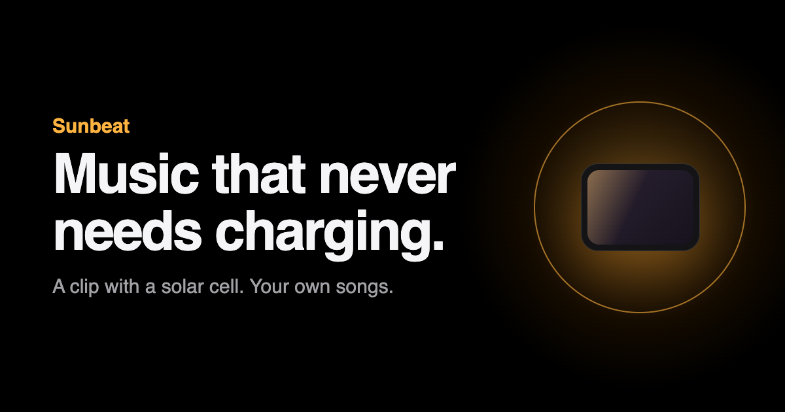

# Sunbeat

**Music that never needs charging.** 
A clip with a solar cell. Your own songs. Your own wired earbuds.

[**Website**](https://sunbeat.vercel.app) &nbsp;·&nbsp; [**3D model**](https://sunbeat.vercel.app/build) &nbsp;·&nbsp; [**Desk test**](#try-it-today) &nbsp;·&nbsp; [**Honest status**](#honest-status)

 

Sunbeat is an open **concept** for a tiny self-powered MP3 player. It started with one pain: *I hate remembering to charge things.* Light is the one strong energy source, so the whole front of the clip is an indoor solar cell. A coin cell is the savings account.

> **Not for sale. Not built yet.** Every hour below is an estimate until the chip power is measured (Step 3).

## How it works

1. **Add songs.** USB-C to a laptop; an app shrinks them to 4-bit ADPCM at 8 kHz (about 14 MB per hour).
2. **Clip it on.** Plug in any wired earbuds (3.5 mm).
3. **Play.** One side button: 1 click play/pause, 2 next, 3 previous, hold = volume.
4. **Forget it.** Room light fills the battery. In the dark it plays about 490 hours (best case). When the battery is low it falls back to a chiptune version of your songs.

Sound comes from one pin (1-bit PWM) through a resistor and a capacitor. The earbud smooths the fast ON/OFF pulses into real sound, like SACD does.

## The numbers (design, not measured)

| | Mini | Big |
|---|---|---|
| Size | 44.0 × 32.6 × 10.8 mm | 44.4 × 55.2 × 11.2 mm |
| Solar cell | 10.8 cm², ~74 µW at 200 lux | 21.6 cm², ~149 µW |
| Battery | 1 × ML2032, 195 mWh | 2 × ML2032, 390 mWh |
| Songs from room light | about 1.5 h/day | about 3 h/day |
| Song memory | 128 MB, about 9 h | same |
| Parts cost (ex VAT, no PCB or case) | ~78 € | ~88 € |

Chosen from common parts sold in Spain (Panasonic AMG-1401C cell, Ambiq Apollo3 module, AEM10941 harvester, Winbond W25N01GV flash). See [the parts list](https://sunbeat.vercel.app/docs/bom).

## Try it today

You only need a Raspberry Pi Pico 2 WH.

- [`DESK-TEST.md`](DESK-TEST.md): flash MicroPython, run [`gestures.py`](gestures.py) (button test, no parts), then wire a resistor and capacitor to hear real songs with [`player.py`](player.py).
- `python3 -I build_songs.py IN_DIR OUT_DIR` makes the song files ([`build_songs.py`](build_songs.py), [`adpcm.py`](adpcm.py)).
- `python3 test_decoder.py` checks that the Pico decoder matches the Mac decoder.
- [`CELL-TEST.md`](CELL-TEST.md): buy and measure test solar cells.

## Honest status

| Part | Status |
|---|---|
| 3D model, parts list, prices | Done (stock in Spain partly unconfirmed) |
| Desk test code | Written, decoder checked on a Mac. **Not run on a Pico yet.** |
| Solar cell test | Plan written, cells not bought |
| Real power use | **Not measured** |
| Song memory power | Open: 2.7 V flash on a 1.9 V rail |
| Circuit board | Concept drawing only |
| Laptop app | Not built |

## Repo

- `site/`: the website (Next.js, deployed to Vercel). `site/public/viewer/` is the 3D model (three.js); `site/content/` holds the docs shown on the site.
- Root `.py` files: player, song converter, energy calculators and button experiments.
- `HANDOFF.md`, `PLAN.md`, `IDEAS.md`: the thinking so far.

MIT.
